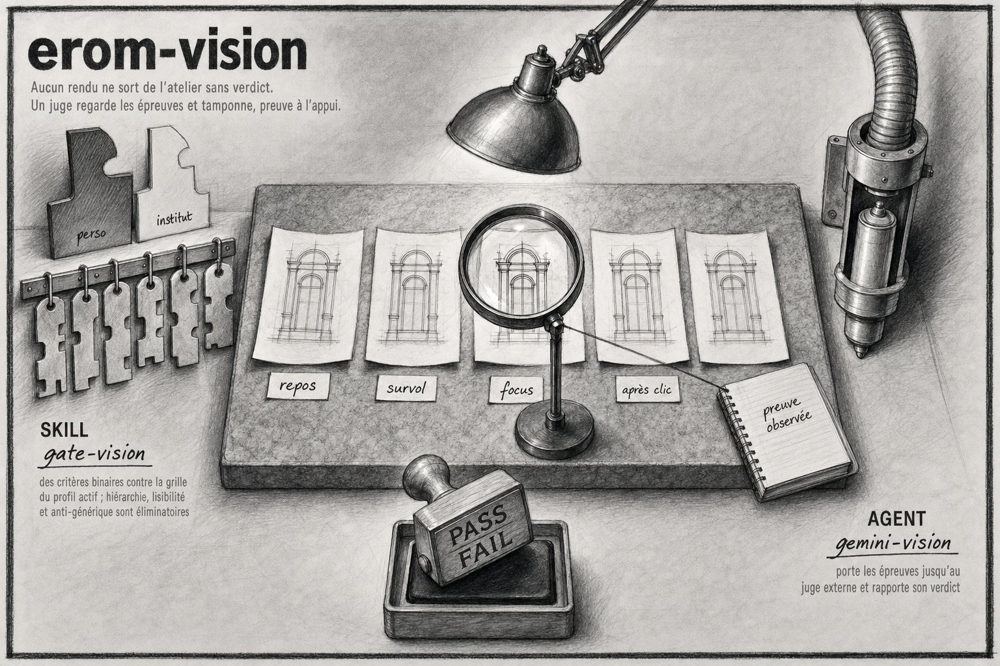

# erom-vision

Plugin Claude Code. Des yeux pour Claude : juge un rendu UI contre la grille eRom (verdict PASS/FAIL ancré sur ce qui est vu, avant de montrer le rendu) et lit vidéos et captures (tests e2e Playwright, enregistrements macOS) en rapport horodaté.

## Installation

```
/plugin marketplace add eRom/erom-marketplace
/plugin install erom-vision@erom-marketplace
```

## Prérequis

Chaque skill a son moteur, installe seulement celui de la skill que tu utilises.

**`gate-vision`** tourne sur Antigravity CLI (`agy`), qui doit être installé et authentifié :

1. installer Antigravity depuis https://antigravity.google
2. lancer `agy` une fois dans un vrai terminal, pour finir l'OAuth

Sans lui, le gate ne rend jamais un PASS silencieux : il affiche un bloc d'échec
explicite qui dit que rien n'a été jugé.

**`glimpse-vision`** appelle le modèle `elorian/glimpse` via OpenRouter :

1. [Bun](https://bun.sh) dans le PATH
2. une clé `OPENROUTER_API_KEY` exportée dans l'environnement du shell
3. `ffmpeg`, seulement pour les vidéos de plus de 20 Mo, que le script réencode lui-même

Coût mesuré : environ 0,06 $ pour 30 s de vidéo, 0,002 $ pour une image.

## Les skills

| Skill | Invocation | Ce qu'elle fait |
|---|---|---|
| `gate-vision` | `/erom-vision:gate-vision [ds=perso\|institut] <image\|url> [<image2> ...]` | Juge une ou plusieurs captures d'un rendu UI contre la grille eRom du profil DS actif (perso dark-first ou institut papier/encre) et rend un verdict PASS/FAIL sur 10 critères binaires, ancré sur ce qui est vu. Le juge ne modifie rien. |
| `glimpse-vision` | `/erom-vision:glimpse-vision <fichier> <question>` | Fait regarder une vidéo (`.mp4`, `.webm`, `.mov`) ou une image par un modèle vision et rend un rapport Markdown horodaté : chronologie, texte à l'écran, anomalies visuelles. Mode `e2e` pour diagnostiquer un test Playwright qui échoue ou un bug d'UI (layout shift, clignotement, overlay qui bloque un clic). |

## Licence

MIT, Romain Ecarnot.
